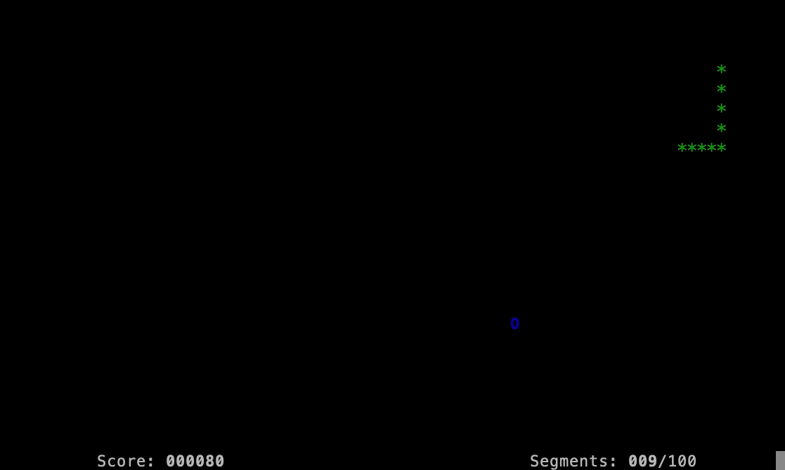

# Snake

  

A terminal version of the arcade game Snake, written in C.

The snake moves continuously around the playing field. Steer it into the fruit
to grow longer and increase your score. The game ends when the snake hits a
wall or runs into itself.

## Controls

- Arrow keys: change direction
- Q: quit
- P: play again (shown on the game over screen)

## Downloading a release

Prebuilt binaries are listed on the [Releases page](https://github.com/isgilbert/snake/releases). 

- Linux: download `snake-linux-x86_64`. Mark it executable with
  `chmod +x snake-linux-x86_64`, then run it from a terminal.
- macOS: download `snake.command` and double click. The game opens in a new
  Terminal window.
- Windows: download `snake-windows-x64.exe` and double click. The game opens
  in a console window.